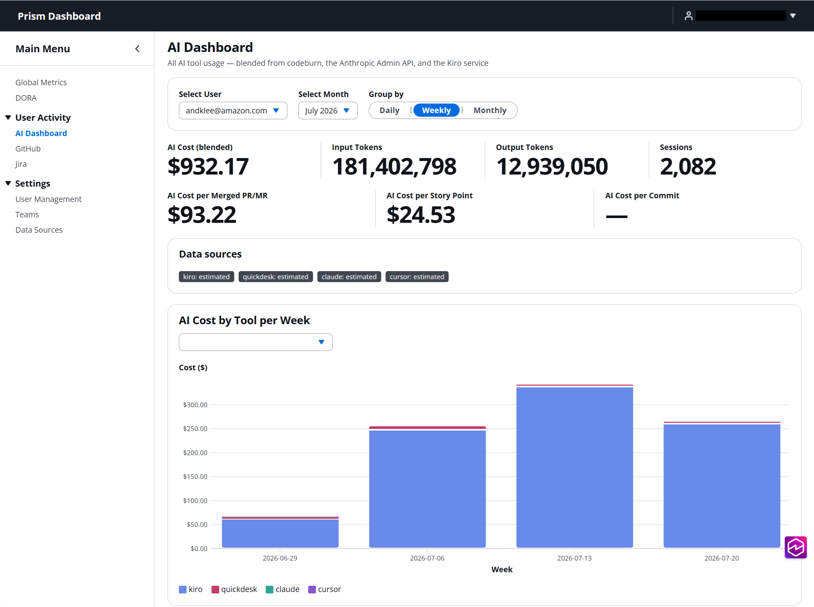
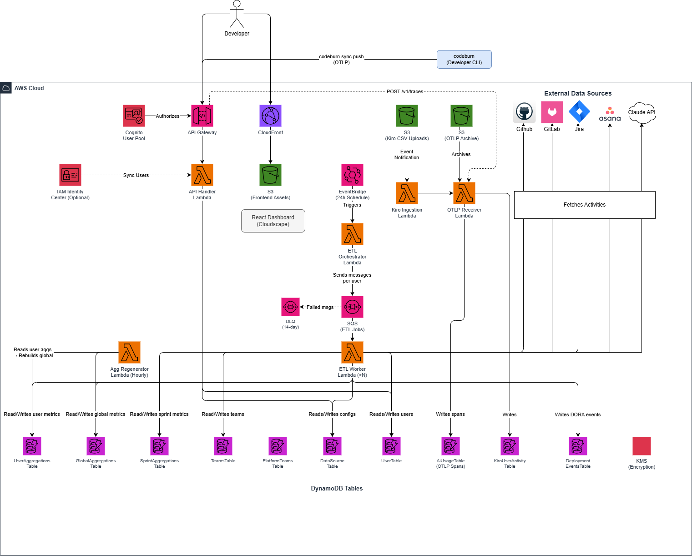
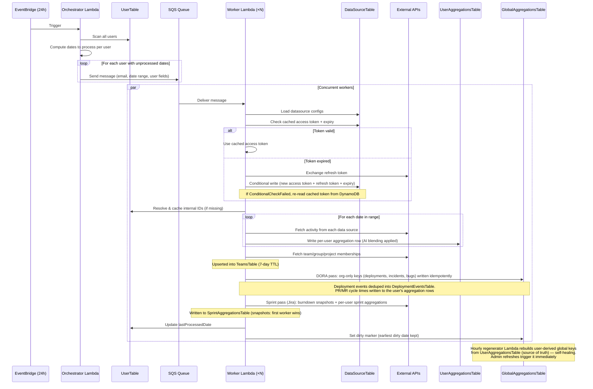

# Prism Dashboard



[](LICENSE)

> **⚠️ Sample Project — Not Production-Ready**
>
> This project is provided as a sample and reference implementation only. It is not designed, tested, or hardened for production use. Use it as a starting point or learning resource, and perform your own security review, testing, and operational hardening before deploying to any production environment.

A self-hosted analytics platform for tracking developer productivity and AI tool adoption. [codeburn](https://github.com/getagentseal/codeburn) is the recommended AI-usage data provider: one OTLP export covers tokens, cost, model, and tool for 35+ AI coding tools, optionally blended with authoritative provider APIs (Anthropic Admin API, Kiro service) for exact figures. AI usage is correlated against delivery metrics from GitHub, GitLab, Jira, and Asana — including all four DORA metrics (deployment frequency and lead time from GitHub/GitLab deployments; change failure rate and MTTR from Jira incidents). Deploy to your own AWS account with a single CDK command.

> 📖 This README covers **deploying** the platform. For using it after deployment — roles, admin setup, data source credentials, teams, DORA/incident configuration, and troubleshooting — see the **[User Manual](USER_MANUAL.md)**.

## Features

- **codeburn OTLP ingestion (recommended AI-usage provider)** — Developers run `codeburn sync` and per-tool AI tokens/cost/model usage flows in for 35+ AI coding tools (Claude Code, Kiro, Cursor, Codex, Gemini, Copilot, …) — one integration instead of one per vendor
- **Source precedence & blending** — codeburn is the estimated baseline; authoritative sources (Anthropic Admin API, Kiro service credits) override per tool per day — never double-counted (see `docs/v1-design.md` §4.5)
- **Unified AI Dashboard** — Blended cost/token charts stacked by tool, source badges (provider-reported / derived / estimated), and model-level breakdowns
- **Full DORA metrics** — All four: Deployment Frequency and Lead Time from GitHub/GitLab deployment events, plus Change Failure Rate and MTTR fed by **Jira incidents** (issues tagged with configurable incident labels), with Elite/High/Medium/Low tier badges and per-team drill-down
- **Delivery metrics** — PR/MR cycle time, time-to-first-review, bug injection ratio, sprint burndown and velocity
- **AI efficiency ratios** — AI cost per story point, per commit, and per merged PR/MR — AI adoption correlated with delivery output
- **Multi-source ETL** — Extensible plugin system pulls data from GitHub, GitLab, Jira, Asana, Claude API, and more on a 24-hour schedule
- **Plugin classification system** — Data sources categorized as CodeTool, IDP, or WorkManagement with automatic chart overlays
- **Role-based access** — Three tiers with server-side enforcement: members see their own data + team aggregates, team owners see their team members' data, admins see everything. Platform teams map GitHub/GitLab/Jira/Asana team constructs to one canonical team for attribution
- **SSO integration** — SAML SSO via IAM Identity Center with Cognito managed login
- **Security by default** — KMS encryption at rest, HTTPS everywhere, input validation, XSS sanitization, SSRF protection, audit logging

## Architecture



## Prerequisites

- Node.js 22+ (20.19+ minimum, required by Vite)
- Python 3.12+
- AWS CDK CLI (`npm install -g aws-cdk`)
- AWS credentials configured with sufficient permissions
- An AWS account with IAM Identity Center enabled

## Quick Start

```bash
# Clone the repo
git clone https://github.com/aws-samples/sample-prism-dashboard.git
cd sample-prism-dashboard

# Install dependencies
cd cdk && npm install && cd ../frontend && npm install && cd ..

# Configure your environment
# Edit cdk/configs/env.ts with your AWS account ID, region, and Cognito domain prefix
# Set initialAdminEmail to lock down the first admin user:
#   initialAdminEmail: 'your-admin@example.com',

# Build and deploy
cd frontend && npm run build && cd ../cdk && npx cdk deploy
```

On first login, the user matching `initialAdminEmail` is bootstrapped as admin. If `initialAdminEmail` is not set, the API refuses all requests on an empty user table (403) — there is no first-user-wins fallback. From there, sync users from IAM Identity Center and configure data sources through the dashboard.

## Configuration

Edit `cdk/configs/env.ts` to configure your deployment:

```typescript
export const stages: Record<string, StageConfig> = {
  dev: {
    name: 'alpha',
    env: {
      account: process.env.CDK_DEFAULT_ACCOUNT || '<your-account-id>',
      region: process.env.CDK_DEFAULT_REGION || 'us-east-1',
    },
    cognitoDomainPrefix: '<your-unique-cognito-domain-prefix>',
    allowSelfRegistration: false, // set true only for non-prod
    initialAdminEmail: 'your-admin@example.com', // locks first-user bootstrap to this email
    // saml: {
    //   providerName: 'IdentityCenter',
    //   metadataUrl: 'https://portal.sso.<region>.amazonaws.com/saml/metadata/<instance-id>',
    // },
  },
};
```

| Setting | Description |
|---------|-------------|
| `account` | Your AWS account ID (or use `CDK_DEFAULT_ACCOUNT` env var) |
| `region` | AWS region to deploy into |
| `cognitoDomainPrefix` | Globally unique prefix for the Cognito hosted UI domain |
| `allowSelfRegistration` | When `true`, any authenticated Cognito user auto-registers. **Use only in non-prod.** |
| `initialAdminEmail` | Email of the designated first admin. When set, only this email can be bootstrapped as admin on first login. **Recommended for production.** |
| `saml` | Optional SAML SSO configuration (see [SSO Setup](#iam-identity-center-sso-optional)) |

## Post-Deploy Setup

### IAM Identity Center SSO (Optional)

1. In the IAM Identity Center console, go to Applications → Add application → Add custom SAML 2.0 application
2. Name it (e.g., "Prism Dashboard")
3. Set the application metadata:
   - ACS URL: `https://<cognitoDomainPrefix>.auth.<region>.amazoncognito.com/saml2/idpresponse`
   - Audience URI: `urn:amazon:cognito:sp:<user-pool-id>` (from stack outputs)
4. Add attribute mappings:

   | Application attribute | Maps to | Format |
   |---|---|---|
   | `Subject` | `${user:email}` | `emailAddress` |
   | `http://schemas.xmlsoap.org/ws/2005/05/identity/claims/emailaddress` | `${user:email}` | `unspecified` |
   | `http://schemas.xmlsoap.org/ws/2005/05/identity/claims/name` | `${user:name}` | `unspecified` |

5. Copy the SAML metadata URL and add it to `configs/env.ts` under `saml`
6. Assign users/groups in Identity Center
7. Redeploy: `cd cdk && npx cdk deploy`

### Data Source OAuth Setup

For OAuth-based data sources (Jira Cloud, Asana, GitLab):

1. Create the data source in the Data Sources page with OAuth App auth type and client credentials
2. Register `https://<cloudfront-domain>/oauth-callback` as the redirect URL in the provider's app settings
3. Click "Authorize" on the data source row to complete the OAuth flow

### codeburn Setup (AI usage telemetry — recommended)

codeburn is the recommended way to get AI usage into the platform: a single client-side integration covers 35+ tools, with no vendor API keys to manage. The Kiro and Claude API plugins are optional refinements that override codeburn's estimates with provider-reported figures (§4.5 blending — never double-counted).

Each developer connects codeburn once, then pushes usage on demand (or via their own cron):

```bash
npm install -g codeburn

# One-time: fetch the discovery doc and log in (opens a browser, PKCE — no secrets stored)
codeburn sync setup <ApiUrl>        # ApiUrl is in the stack outputs (also emitted as CodeburnSyncSetupCommand)

# Push usage (repeat any time; already-sent spans are deduplicated server-side)
codeburn sync push

codeburn sync status                # show endpoint + auth status
```

How it works: `setup` reads `<ApiUrl>/.well-known/codeburn-export.json`, logs the developer in against the platform's Cognito user pool (loopback callback on `127.0.0.1:19876-19878`), and stores tokens locally. `push` sends OTLP batches to `POST /v1/traces`; the receiver archives raw batches to S3 and writes deduplicated spans keyed to the developer's own identity. Usage appears on the AI Dashboard after the next ETL run (or **Refresh Data**).

> Developers must be **registered platform users** (synced from IAM Identity Center or admin-created) *before* their first push — the receiver resolves the JWT email to the user's stable internal id and rejects unregistered users (the raw batch is still archived to S3, so pushes can be replayed after registration with `codeburn sync reset --confirm && codeburn sync push --since all`).

### DORA Configuration

Deployment frequency and lead time are derived from GitHub/GitLab deployment events:

1. On the GitHub/GitLab data source, set **prodEnvironments** (comma-separated environment names, default `production,prod`) — only deployments to these environments count
2. Lead time = deploy time − head-commit time (per-deploy lower bound; percentiles computed at query time)
3. Change Failure Rate = (failed deployments + Jira incidents opened) / deployments; MTTR = mean resolution time of Jira incidents
4. Incidents are Jira issues carrying one of the labels configured in the Jira data source's **Incident Labels** field (comma-separated, default `incident`)

### Application Setup

1. Sync users from IAM Identity Center via the User Management page
2. Edit each user to set data source identifiers (GitHub username, GitLab username, etc.) — internal IDs are resolved automatically
3. Add data sources via the Data Sources page (credentials are validated on save)
4. Upload Kiro activity CSVs to the S3 bucket under the `kiro-user-activity-logs/` prefix
5. The ETL runs every 24 hours, or use "Refresh Data" for immediate processing


## Dashboard Pages

| Page | Description |
|------|-------------|
| Global Metrics | Summary cards (blended AI cost, commits, issues, bug injection ratio, AI efficiency ratios) and bar charts with CodeTool overlays |
| DORA | Deployment Frequency, Lead Time, Change Failure Rate, and MTTR cards with tier badges, trend charts with CodeTool overlays |
| AI Dashboard | All AI tools in one view: blended cost/tokens stacked by tool, source badges, model breakdown — providers appear generically, no per-provider tabs |
| GitHub Activity | Commits/PRs per day, avg PR cycle time and time-to-first-review, team view toggle, CodeTool overlays |
| GitLab Activity | Commits/MRs per day, avg MR cycle time and time-to-first-review, group view toggle, CodeTool overlays |
| Jira Activity | Issues, story points, bug injection ratio, sprint burndown and velocity, team view, CodeTool overlays |
| Asana Activity | Tasks and story points with team view and CodeTool overlays |
| User Management | Sync users, edit identifiers (including Claude API email), refresh data (admin only) |
| Data Sources | Add/edit/delete integrations with auth validation |

Role-based access: Admins see everything. Team owners see their team members' data and team aggregates. Members see their own data and their team's aggregates.

## Data Source Plugins

Data sources are classified into three categories that determine how their metrics are displayed:

| Category | Description | Sources |
|----------|-------------|---------|
| **CodeTool** | AI coding tools — metrics are automatically overlaid as line charts on IDP and WorkManagement pages | codeburn (35+ tools), Kiro, Claude API |
| **IDP** | Inner Developer Platforms — primary bar charts with CodeTool overlays | GitHub, GitLab |
| **WorkManagement** | Project tracking tools — primary bar charts with CodeTool overlays | Jira, Asana |

CodeTool overlays are configured centrally in `frontend/src/overlayConfig.ts`. Adding a new overlay entry there automatically surfaces it as a toggle on all IDP, WorkManagement, and Global Metrics pages.

| Plugin | Category | Auth Types | Metrics |
|--------|----------|-----------|---------|
| GitHub | IDP | PAT, GitHub App | Commits, PRs, PR reviews, PR cycle/first-review times, deployments, team memberships |
| GitLab | IDP | PAT, OAuth App | Commits, MRs opened/merged, MR cycle/first-review times, deployments, group memberships |
| Jira | WorkManagement | API Token, OAuth 2.0 | Issues by type, story points, bugs opened, sprint metrics + burndown snapshots, project memberships |
| Asana | WorkManagement | PAT, OAuth App | Tasks completed, story points, team memberships |
| codeburn **(recommended)** | CodeTool | Built-in (OTLP receiver) | Tokens, estimated cost, model, sessions per tool for 35+ AI coding tools — the one-stop AI-usage provider; Kiro/Claude API below are optional authoritative overrides |
| Kiro | CodeTool | Built-in | Messages, conversations, credits (cost derived at a configurable $/credit rate) |
| Claude API | CodeTool | Admin API Key | Sessions, lines of code, commits, PRs, tool acceptance, estimated cost, tokens ([Anthropic Admin API](https://docs.anthropic.com/en/api/usage-cost-api)) |

### Adding a New Data Source

Backend registration lives in two places; the frontend is a single registry entry.

1. Add the type to `DataSourceType` enum in `datasources/__init__.py` **and** to `DATASOURCE_TYPES` in `cdk/lambda/shared/datasource_registry.py` (the worker asserts they match at import time). If users carry a per-user identifier, add its field to `DATASOURCE_USER_FIELDS` (and `DATASOURCE_INTERNAL_ID_FIELDS` if internal IDs are resolved) — validation, ETL SQS messages, and the worker field maps all derive from this
2. Create a module extending `BaseDataSource` with:
   - `config_schema` — UI field definitions
   - `resolve_internal_id()` — look up the API ID from a user identifier
   - `fetch_activity(date_str)` — fetch metrics for a date
   - `get_aggregation_fields(activity)` — map to aggregation fields
3. Register in `datasources/registry.py`
4. Metric keys need no API registration — every numeric field written to user rows flows through `/aggregations`, `/global-aggregations`, and `/team-aggregations` dynamically. Org-only metrics (no per-user rows) must be registered in `cdk/lambda/shared/metric_keys.py` `ORG_ONLY_KEYS` and written from the worker with a `validate_org_only` guard
5. Frontend: add ONE entry to `DATA_SOURCE_REGISTRY` in `frontend/src/datasourceRegistry.tsx` (label, description, category, icon, auth options, config fields, optional OAuth settings) — the Data Sources page, the Add Data Source wizard, and the overlay category mapping all derive from it
6. If it's a CodeTool, add overlay entries to `CODE_TOOL_OVERLAYS` in `overlayConfig.ts`
7. Optionally create a dedicated activity page

## ETL Pipeline

The ETL runs every 24 hours via EventBridge, using a fan-out architecture:



The orchestrator compares each user's `lastProcessedDate` against yesterday to determine unprocessed dates. Today is always included so partial-day data gets updated on the next run. Failed SQS messages retry 3 times before going to a dead-letter queue (14-day retention).

OAuth plugins use optimistic locking via DynamoDB conditional writes to handle concurrent token refresh safely — only one worker exchanges the refresh token per expiry cycle.

## Security

This project implements multiple layers of security:

- **Encryption** — KMS encryption at rest for all DynamoDB tables and S3 buckets. HTTPS for all traffic.
- **Authentication** — Cognito User Pool with JWT validation on API Gateway. Optional SAML SSO.
- **Authorization** — Three-tier role model (admin / team owner / member) enforced server-side with default-deny endpoint registration: every route must declare an access tier or non-admin requests are rejected. Non-admin profile updates are filtered to a writable-field allowlist.
- **Input validation** — XSS sanitization (`html.escape`) and dangerous character blocking on all write endpoints. Email, URL, date, and identifier format validation.
- **SSRF protection** — Data source URL fields are validated to block private, loopback, reserved, and link-local IP addresses.
- **Audit logging** — Structured JSON audit events for sensitive operations (user CRUD, role changes, data source management, Identity Center sync).
- **API throttling** — 50 req/s steady-state, 100 burst at the API Gateway stage level. Lambda reserved concurrency of 25.
- **Security headers** — HSTS (1-year, preload), X-Content-Type-Options: nosniff, X-Frame-Options: DENY, CSP restricting sources to self and AWS domains.
- **IAM scoping** — Lambda roles follow least-privilege.

> **Note:** First-user bootstrap requires `initialAdminEmail` in your stage config — only that email can be bootstrapped as admin on an otherwise-empty deployment. Without it, the API returns 403 until it is configured (no silent first-user-wins promotion).

## Project Structure

```
├── cdk/                  # AWS CDK infrastructure
│   ├── bin/              # CDK app entry point
│   ├── configs/          # Stage/environment configuration (env.ts)
│   ├── lambda/
│   │   ├── api-handler/                    # API CRUD, queries, OAuth, data sources
│   │   │   ├── auth.py                     # Role resolution, endpoint authorization, data scoping
│   │   │   ├── validation.py               # Input validation, XSS sanitization, SSRF protection
│   │   │   ├── audit.py                    # Structured audit logging
│   │   │   └── routes/                     # Route handlers (users, activity, teams, datasources)
│   │   ├── otlp-receiver-lambda/           # codeburn OTLP span receiver
│   │   ├── etl-processor-lambda/           # ETL orchestrator
│   │   ├── etl-processor-worker-lambda/    # ETL worker — thin orchestrator + feature modules
│   │   │   │                               #   (user_aggregation, dora_metrics, sprints, team_repos, regen_signals)
│   │   │   └── datasources/               # Data source plugins
│   │   ├── agg-regenerator-lambda/         # Rebuilds user-derived global aggregates (single writer)
│   │   ├── kiro-user-activity-lambda/      # S3 CSV ingestion
│   │   └── shared/                         # Modules symlinked into consuming lambdas
│   │                                       #   (datasource_registry, metric_keys, crypto, dynamo_utils, refresh_window)
│   ├── lib/
│   │   ├── constructs/   # CDK constructs (KiroIngestion, AiUsageIngestion, APIStorage, Dashboard, ETLProcessor)
│   │   │                 #   + resource-helpers.ts (shared CMK/table/access-log-bucket factories)
│   │   └── prism-dashboard-stack.ts
│   └── scripts/          # Utility scripts
├── frontend/             # React dashboard (Vite + Cloudscape + Amplify v6)
│   ├── index.html        # Vite entry point
│   ├── vite.config.ts    # Vite build config (outputs to build/ for CDK deployment)
│   └── src/
│       ├── components/   # Shared components
│       ├── pages/        # Page components
│       ├── api.ts        # API client with auth
│       ├── chartUtils.ts # Chart overlay utilities
│       ├── datasourceRegistry.tsx # Single source of truth for datasource UI metadata (icons, schemas, auth, OAuth, categories)
│       ├── overlayConfig.ts # CodeTool/IDP/WorkManagement category system and overlay definitions
│       ├── useActivityData.tsx # Shared data hook for the per-source activity pages (pairs with components/ActivityPageShell)
│       ├── useCodeToolOverlays.ts # Shared React hook for CodeTool overlay toggles
│       ├── config.ts     # Runtime config loader
│       ├── dateRanges.ts # Date range utilities
│       └── UserContext.tsx # React context for role and user record
└── terraform/            # Terraform infrastructure (planned)
```

## DynamoDB Tables

| Table | PK | SK | Purpose |
|-------|----|----|---------|
| KiroUserActivityTable | uuid | timestamp | Raw Kiro activity logs |
| UserTable | email | — | User profiles, Identity Center IDs, data source identifiers |
| DataSourceTable | uuid | — | Integration configs (PATs, OAuth tokens, connection settings) |
| UserAggregationsTable | userId | date | Per-user daily metrics from all sources |
| GlobalAggregationsTable | month | date | Pre-computed daily totals across all users |
| TeamsTable | source | teamName | Team memberships per data source (TTL: 7 days) |
| PlatformTeamsTable | teamName | — | Platform teams: owners, source mappings, repos (no TTL) |
| SprintAggregationsTable | sprintId | userId / SNAPSHOT#date | Per-user metrics per Jira sprint + daily burndown snapshots |
| AiUsageTable | userId (stable UUID) | SPAN#startNano#spanId | Raw codeburn OTLP spans, deduplicated (TTL: 90 days) |
| DeploymentEventsTable | service | deployedAt#deployId | Deployment events with lead time (DORA) |

## CSV Schema

Kiro activity CSV files uploaded to S3:

| Column | Description |
|--------|-------------|
| Date | Activity date (YYYY-MM-DD) |
| UserId | IAM Identity Center user UUID |
| Client_Type | KIRO_IDE, KIRO_CLI, or PLUGIN |
| Subscription_Tier | PRO, ProPlus, or Power |
| ProfileId | Profile ARN |
| Total_Messages | Messages sent to and from Kiro |
| Chat_Conversations | Conversations during the day |
| Credits_Used | Credits consumed |
| Overage_Enabled | Whether overage is enabled |
| Overage_Cap | Overage limit |
| Overage_Credits_Used | Overage credits used |

## Generate Test Data

```bash
python cdk/scripts/generate-test-data.py <bucket-name> --days 14 --users 3
```

## Contributing

Contributions are welcome. Please open an issue first to discuss what you'd like to change.

1. Fork the repo
2. Create a feature branch (`git checkout -b feature/my-feature`)
3. Commit your changes
4. Push to the branch and open a Pull Request

## License

This project is licensed under the MIT License — see [LICENSE](LICENSE) for details.
